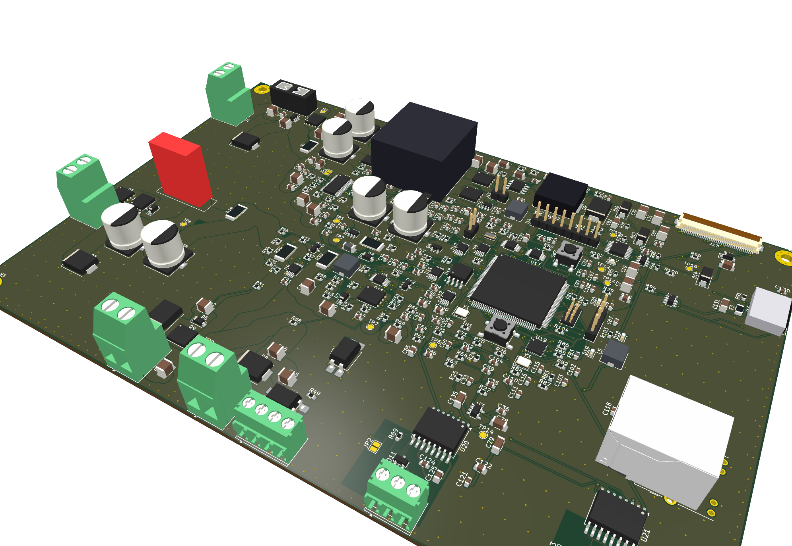

# MPPT solar charge controller (STM32H743, LM5177 buck-boost)

PV 0-48 V, battery 12-48 V, switched load, DC feed + control port for an external 220 V inverter, Ethernet / isolated CAN / isolated RS485 / USB-C / display.
Design only (not built, not validated). KiCad 10 project generated from code.

| Doc | Content |
|---|---|
| [docs/00-overview.md](docs/00-overview.md) | What it is, pictures (schematic, PCB, 3D), use cases, comparison with a standard MPPT controller |
| [docs/01-requirements.md](docs/01-requirements.md) | Requirements and assumptions |
| [docs/02-architecture.md](docs/02-architecture.md) | Architecture, part choices, open design items |
| [docs/03-pinmap.md](docs/03-pinmap.md) | STM32 pin allocation (generated) |
| [docs/04-handover.md](docs/04-handover.md) | Current state, what is left, pipeline commands |

Sources: `hardware/mppt_controller.py` (SKiDL generator) -> schematic -> `hardware/place_pcb.py`, routing scripts, `hardware/rebuild.sh`.
