# MPPT controller: overview, use cases and what it can achieve

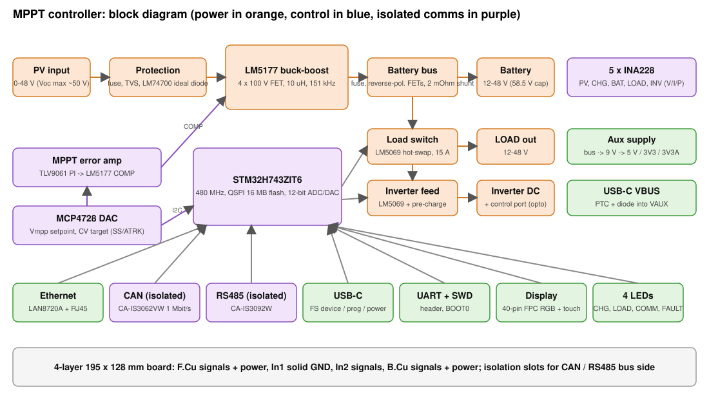

**Status:** design only, nothing has been fabricated or measured. Schematic complete (ERC clean), PCB placed and about 95 % routed
(see `04-handover.md`). Every performance statement below is a design target taken from the datasheets and the schematic, not a measurement.

## 1. What the board is

A programmable solar charge controller and DC power manager in one 195 x 128 mm, 4-layer board:

| | |
|---|---|
| PV input | 0-48 V (designed for Voc up to about 50 V; hardware survives to ~82 V TVS clamp) |
| Battery | 12-48 V nominal packs, hardware charge-voltage cap about 58.5 V (16S LiFePO4 = 58.4 V charge) |
| Charge power | about 10 A battery-side, so about 500 W at 48 V (120 W at 12 V: the limit is current, not power) |
| Power stage | TI LM5177 four-switch buck-boost, 4 x 100 V N-FETs, about 151 kHz |
| Load output | switched battery bus, 12-48 V, hot-swap with current limit and under-voltage cut-off (about 15 A) |
| Inverter output | switched, fused DC feed with pre-charge / inrush control, plus an isolated control port (remote on/off, power-good, fault) for an external 220 V AC inverter |
| Brain | STM32H743ZIT6 (480 MHz), 16 MB QSPI flash, 4 LEDs |
| Measurement | 5 x INA228 (PV, charge, battery, load, inverter: voltage, current, power, energy), redundant ADC dividers, 3 NTC inputs |
| Interfaces | Ethernet (RJ45), isolated CAN (1 Mbit/s), isolated RS485, USB-C (programming, serial, and bus power for bench work), UART header, SWD, 40-pin FPC for a 4.3 in 480 x 272 RGB display with touch, SPI display header |
| Power for the board | from the battery bus (9 V buck -> 5 V / 3.3 V), or from USB VBUS when no battery is connected |

## 2. Pictures

### Schematic (hierarchical, 17 sheets; full set in `img/schematic.pdf`)
The sheets are generated from code and use net labels, not drawn wires.

| Power stage (LM5177 + FETs) | PV input protection |
|---|---|
| 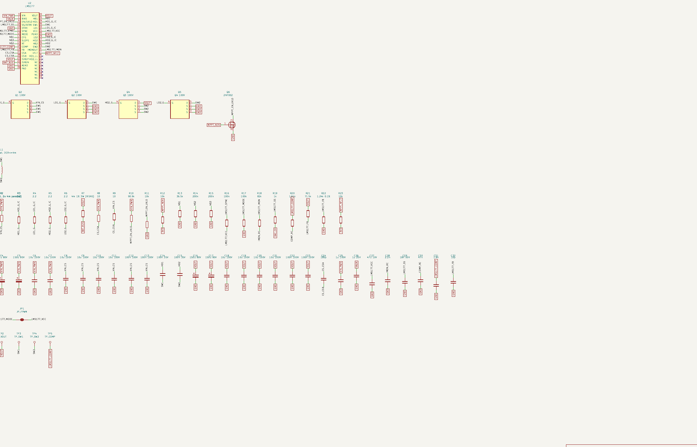 |  |

| Sensing (5 x INA228) | Aux power | MCU |
|---|---|---|
| 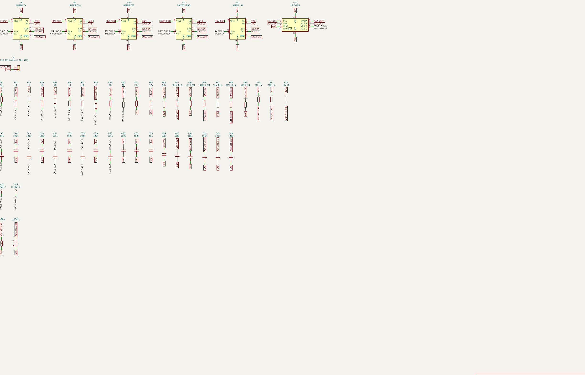 | 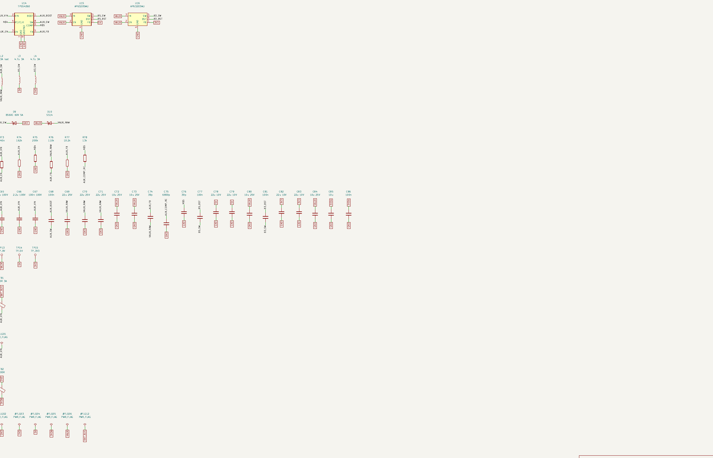 | 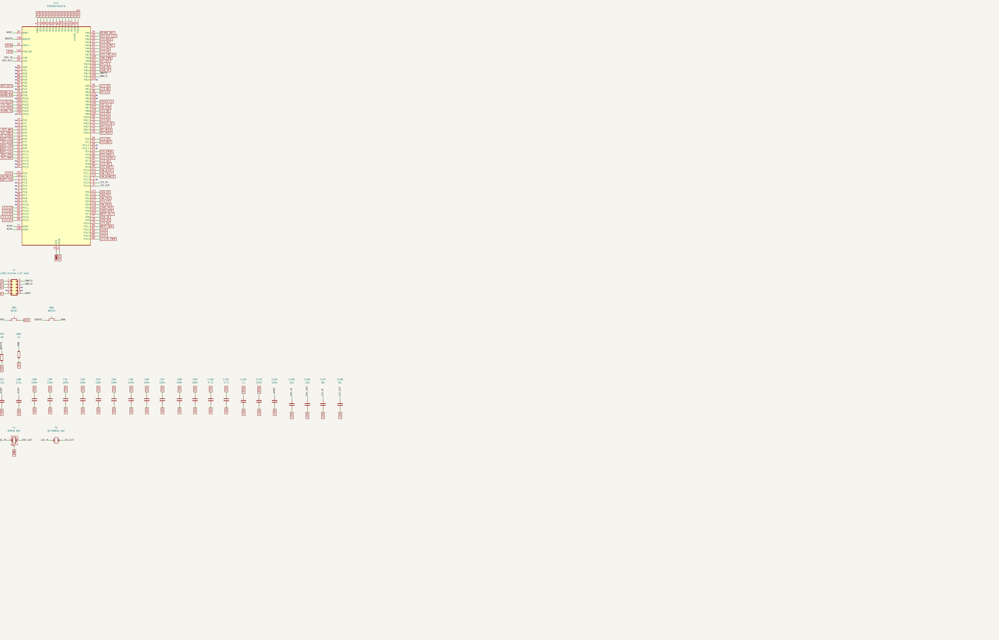 |

### PCB (work in progress, snapshot 2026-11-10)
Top copper and silkscreen (red = F.Cu, large areas are GND pour and high-current copper):

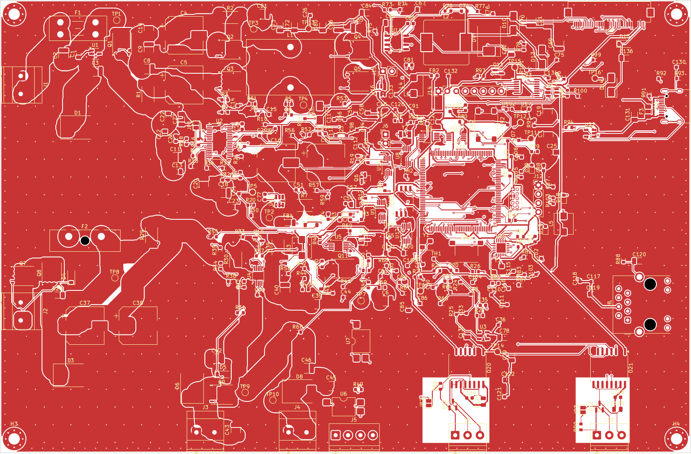

Bottom copper:

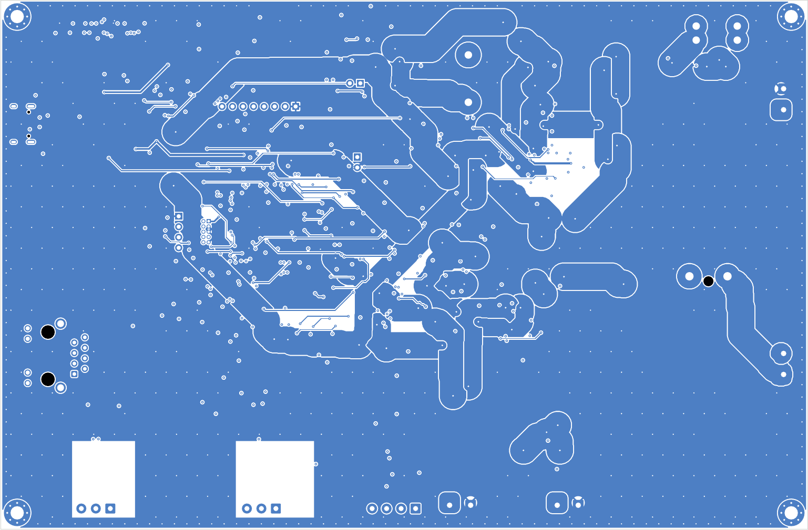

### PCB editor and 3D viewer (screenshots, 2026-11-10)
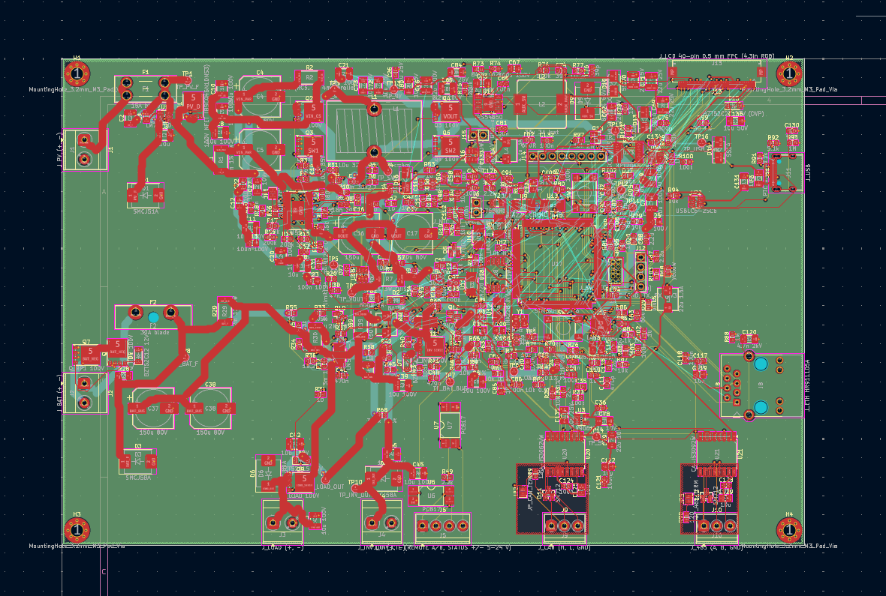
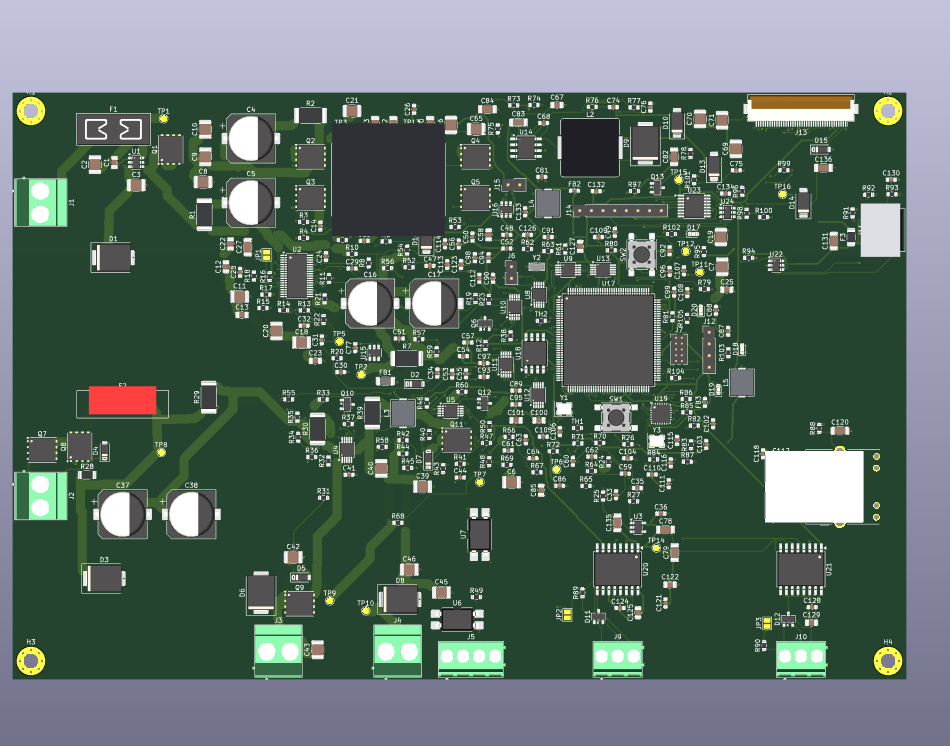

### 3D model
Top view and an angled view. L1 (toroid), L2, the fuse holder and the USB-C jack are placeholder boxes; the RJ45 is the
vendor model (HR911105A).

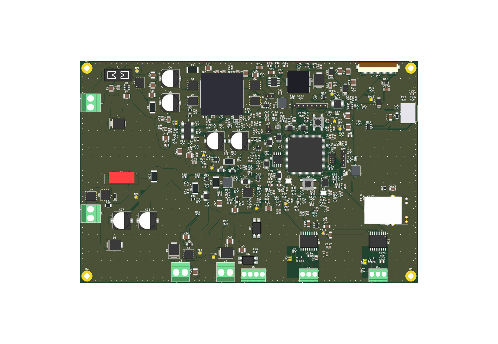
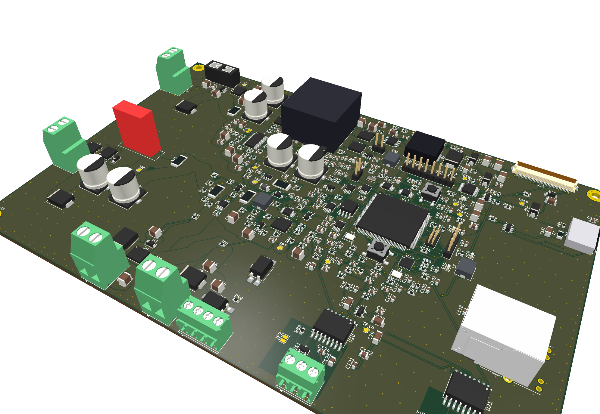

## 3. What this board can achieve

1. **MPPT with a PV voltage below, at or above the battery voltage.** The four-switch buck-boost keeps tracking when the array
   voltage falls below the battery (low light, hot panels, a 24 V array on a 48 V pack, a 12 V panel on a 24 V battery).
   A plain buck MPPT stage stops at Vpv ~ Vbat + a few volts.
2. **Real use of the whole range with one design:** 12 V, 24 V and 48 V batteries and arrays from a single panel up to a 48 V string,
   without changing hardware. The battery chemistry and charge profile (CC/CV, float, temperature compensation, LiFePO4 / lead-acid /
   Li-ion) are firmware, because the CV target comes from a DAC and the hardware only sets a safety cap.
3. **Programmable, auditable control loop.** The firmware sets the MPPT voltage reference, scans the PV curve to find the global
   maximum under partial shading, and logs every channel at kHz rates using the INA228 and the STM32 ADC. This is the point of the board
   as a research / custom-firmware platform.
4. **Full energy accounting.** PV power, charge power, battery power, load power and inverter power are measured separately,
   with energy counters: you can compute conversion efficiency, battery state of charge (coulomb counting), and per-load consumption.
5. **Power management for a complete off-grid system:** load disconnect on low battery, inverter enable with controlled pre-charge so
   an inverter's input capacitors do not trip a fuse or damage a relay, remote control of the inverter, fault latching.
6. **Networked and bus-integrated:** Ethernet for a web UI / MQTT / Modbus-TCP, isolated CAN and RS485 for BMS, inverter and
   battery communication (galvanic isolation protects the controller from noisy buses), USB-C for configuration.
7. **Local display and touch:** a 4.3 in colour panel for live status without a PC.
8. **Updatable:** 16 MB external flash for logs, firmware images, graphics, and configuration; ROM bootloader on USB and UART, SWD.

## 4. Compared with a standard (commercial) MPPT controller

"Standard" here means a typical consumer or small-system MPPT charge controller. Individual products vary a lot; this is a
comparison of design class, not of specific models.

| | Typical MPPT controller | This board (design target) |
|---|---|---|
| Topology | Synchronous buck (PV voltage must stay above battery voltage + margin) | Four-switch buck-boost: tracks below, at and above battery voltage |
| Input range | Often 100-250 V PV, one fixed battery group per model | 0-48 V PV only (Voc <= ~50 V), 12-48 V battery in one board |
| Power | 200 W to several kW per unit | about 10 A, max ~500 W at 48 V |
| Firmware | Closed, a few charge-profile presets | Open: any algorithm (global-maximum scan, custom profiles, grid-forming experiments) |
| Telemetry | Voltage / current / yield, sometimes Bluetooth | Five separate V/I/P/E channels, Ethernet, CAN, RS485, USB, display |
| Load output | Simple low-voltage disconnect, 10-20 A | Hot-swap load switch, current-limited, firmware cut-off |
| Inverter integration | Usually none (separate relay or BMS) | DC feed with pre-charge and an isolated control port |
| Isolation | Rare on communication ports | CAN and RS485 galvanically isolated |
| Safety / certification | CE/UL, field-proven, long warranty | None: prototype, no certification, firmware and control loop not validated |
| Efficiency | Typically 96-99 % in buck mode | Not measured. A buck-boost loses more when it must boost or buck-boost; expect lower efficiency in the mixed region |
| Cost and effort | Buy it, wire it | Design, assembly, firmware and validation are all on you |

Where it is clearly better: **flexibility, observability and integration** (one board, any battery 12-48 V, own control
algorithm, full telemetry, comms, inverter management). Where a commercial unit is clearly better: **proven reliability, higher PV
voltage and power, certification and support**.

## 5. Typical use cases

- 12 / 24 / 48 V off-grid cabin, van or boat system with a DC load and a 220 V inverter on the same battery.
- Research and teaching platform for MPPT algorithms (P&O, incremental conductance, global scan for partial shading).
- Small solar + battery system with remote monitoring (Ethernet / CAN) and a BMS on the CAN bus.
- Test bench for battery chemistries with a controlled charge profile and complete energy logging.
- Portable DC power station controller with display and inverter control.

## 6. Limits and open risks (design review)

- **The MPPT loop is my own design.** The LM5177 has no input-voltage regulation. The board forces the PV voltage by pulling COMP
  down with an op-amp stage. It is not a TI-validated configuration and must be simulated and tuned on the bench.
- **PV Voc <= ~50 V.** Cold-weather open-circuit voltage of a string must stay below the LM5177 limits; the TVS clamp
  (82 V) is below the 85 V absolute maximum but there is little margin for surges.
- **Battery-side surge clamp** (SMCJ58A clamps ~93.6 V) is above the 85 V absolute maximum of the LM5177 pins; load-dump style
  events need a better clamp.
- **Thermal:** 10 A at 48 V is 480 W of throughput; losses must be removed by 2 oz copper and airflow (a fan output exists). The
  inductor (10 uH, >= 25 A saturation) is currently a placeholder and probably off-board.
- **Not yet verified:** display pinout against a real panel, hot-swap tuning, RJ45 LEDs not wired, the Chinese CA-IS3062VW datasheet pin table.
- Not certified, not intended as a finished product without validation, protection testing and a safety review.

See `02-architecture.md` section 2.7 for the full list.
